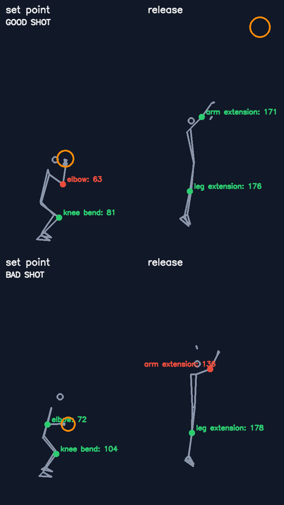

# Basketball Shot Form Analysis
 
Give it a side-on video of a basketball shot. It finds the **set point** (where the ball is loaded, knees bent) and the **release**, measures the elbow, arm, and knee/leg angles at those two moments, and tells you what to fix. The output is a stick-figure drawing and animation, so it shows your form without showing the person.



*Two of my own practice clips, drawn as skeletons. Green passes the check, red doesn't. In the good shot the arm (171°) and legs (176°) are fully extended at release. In the other, the shooting arm only reaches 136°.*

Animations: [good shot](assets/good_shot.gif) · [other shot](assets/bad_shot.gif)

## How it works

```
video -> body pose (MediaPipe) + ball (YOLO) per frame
      -> elbow / knee angles over time
      -> release = ball leaves the hand near the wrist's highest point
      -> set point = deepest knee bend in the seconds before the release
      -> rule-based feedback + skeleton-only drawings
```

- [`shotform/pose.py`](shotform/pose.py): MediaPipe pose, returning joints in pixel coordinates.
- [`shotform/ball.py`](shotform/ball.py): YOLO ball detector (fine-tuned weights if present, generic COCO model otherwise).
- [`shotform/analysis.py`](shotform/analysis.py): per-frame measurements, key-frame detection, and the feedback rules with their thresholds.
- [`shotform/render.py`](shotform/render.py): the skeleton-only drawings.
- [`analyze_shot.py`](analyze_shot.py): the command-line tool. [`notebooks/demo.ipynb`](notebooks/demo.ipynb) walks through it step by step.

## Run it

```bash
python -m venv .venv && source .venv/bin/activate
pip install -r requirements.txt
python analyze_shot.py my_shot.mp4 --side right --out output/
```

```
Set point at frame 76, release at frame 91
  ✗ set point: elbow         63.2°   Elbow should be close to a right angle (about 90 degrees) when you set the ball.
  ✓ set point: knee bend     81.2°
  ✓ release: arm extension   171.3°
  ✓ release: leg extension   176.0°
```

It writes `set_point.png`, `release.png`, `skeleton.gif` and `feedback.json` to `output/`. Use a side-on camera with the whole body in frame, and `--side left` for left-handed shooters. Tests: `python -m pytest`.

## The ball detector

By default the ball is found with the generic COCO YOLOv8n "sports ball" class. A detector fine-tuned on my own data does much better, so the project includes the scripts to train and evaluate one.

**Data.** About a thousand images (photos and frames from my own videos) with the basketball labeled in Roboflow: 888 for training, 84 for validation and 42 for testing, with 957, 91 and 48 ball boxes.

**Fine-tuning.** YOLOv8n starting from the COCO weights, 512 px images, batch size 8, 30 epochs on a laptop CPU (about 100 minutes). Both detectors were scored on the same 42 held-out test images by [`scripts/evaluate_ball_detector.py`](scripts/evaluate_ball_detector.py):

| Detector | AP50 | AP50-95 | Recall at confidence 0.25 |
|---|---:|---:|---:|
| Generic COCO YOLOv8n ("sports ball") | 0.39 | 0.32 | 4% |
| **Fine-tuned on my images** | **0.98** | **0.81** | **100%** |

(AP50 counts a detection as correct at 50% box overlap; AP50-95 averages stricter thresholds up to 95%. At the usual 0.25 confidence cutoff the generic model finds only 2 of the 48 balls, though it rarely gives false alarms. Both detectors had precision 1.0 there.)

As an informal check on clips from a different gym that the model never saw, the fine-tuned detector finds the ball in 35-39% of frames versus 13-21% for the generic one, roughly twice as often. I have no frame-by-frame labels for those clips, so that is a relative comparison only.

**How far to trust this.** The test set is small (48 balls), and the images come from the same collection as the training images, including neighboring frames from the same videos, so the headline scores are likely optimistic for a new gym or camera. On my two practice clips the detected key frames and angles came out the same with either detector, because the release falls back to the wrist's highest point when the ball is lost. The better detector mainly improves how well the ball's path is tracked.

**Using it.** The trained weights are not included (the photos show other people, so I'm keeping the data and the model private). Train your own on a Roboflow YOLO export:

```bash
python scripts/train_ball_detector.py --dataset path/to/export --device cpu --batch 8 --imgsz 512 --epochs 30
python scripts/evaluate_ball_detector.py --dataset path/to/export
```

The first command saves `models/ball_yolov8n.pt`, which `analyze_shot.py` then uses automatically.

## Timeline: an older project I'm brushing up

| When | What |
|---|---|
| Oct 2024 | Collected ball photos and videos, labeled the basketball in Roboflow |
| Dec 2024 – Jan 2025 | First working version: a hosted Roboflow detector plus MediaPipe pose and hand-written angle rules, as notebooks ([`legacy/`](legacy)) |
| Oct 2026 | Rebuilt as a small package and command-line tool, fixed several problems (below), added skeleton-only output and tests, and retrained the ball detector locally to compare it with the generic one |

**What the first version did.** It checked whether the player was "squared up" (knee angle near 90°) and whether the arm and legs were straight at release, then wrote feedback like "bend your knees more". I kept that idea and these findings.

**What I changed, and why**

- **An inverted check.** The old "arm should be straighter" rule fired when the angle was *above* 10°, so it flagged every shot, since a straight arm measures about 180°. It now requires roughly 150° or more at release.
- **Angles in pixels, not normalized coordinates.** On a tall phone video, normalized coordinates stretch angles.
- **Sideways phone videos.** Many phones store video sideways with a rotation flag. Without applying it, the pose model was looking at a rotated person. It now reads frames upright.
- **Time instead of single frames.** Instead of grabbing the first frame that matched a rule, it now looks at the whole motion to find the release and the deepest knee bend.
- **No API key, no hosted model.** The detector runs locally.
- **Reference ranges from pros.** I measured two professional reference clips to set the thresholds (set-point elbow about 70–95°, knee about 110–130°; release arm about 150–170°, legs about 165–172°).

## Limitations

- The thresholds are rules of thumb. I have **not** validated them against coach ratings, and I've only compared two of my own clips, so treat the output as measurements with suggestions, not a verdict.
- It assumes one shooter, a side-on camera, and the whole body in frame.
- Pose estimation is noisy when the ball or an arm hides a joint, and the generic ball detector often loses the ball to motion blur. When it does, the release falls back to the wrist's highest point.
- A natural next step is to collect labeled good and bad shots and fit the thresholds (or a small classifier) on them.

Videos, photos and the training dataset are not included: they show people, and some are third-party footage.

## Credits

[MediaPipe](https://github.com/google-ai-edge/mediapipe) (pose), [Ultralytics YOLO](https://github.com/ultralytics/ultralytics) (detection), and [Roboflow](https://roboflow.com) (labeling).

## License

MIT
